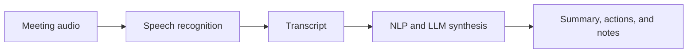

# Smart-Meeting-Synthesizer

## Architecture


An AI-powered meeting assistant that automatically records, transcribes, and summarizes meetings into concise, actionable insights.
This notebook leverages speech recognition, natural language processing, and LLM summarization to create structured meeting notes effortlessly.

---
## 🚀 Features

- *🎙️ Speech-to-Text Conversion* – Converts meeting audio into text using automatic speech recognition.

- *📝 Summarization* – Generates concise meeting summaries using a generative language model.

- *🔍 Keyword & Action Extraction* – Identifies key decisions, tasks, and important discussion points.

- *📊 Speaker Identification (optional)* – Differentiates between speakers for clearer context.

- *💾 Export Options* – Save outputs as .txt, .pdf, or .csv summaries.

---
## 🧩 Tech Stack

| Component | Technology |
|------------|-------------|
| Notebook | Jupyter Notebook |
| Programming Language | Python 3.x |
| Speech Recognition | speech_recognition, gTTS |
| NLP / Summarization | Google Gemini |
| UI | Gradio |
| Audio Processing | pydub, ffmpeg, librosa |
| Visualization | matplotlib, wordcloud |

---
## ⚙️ Installation

### 1. Clone this repository:
```bash
git clone https://github.com/AryaLolusare2712/smart-meeting-synthesizer.git
cd smart-meeting-synthesizer
```

### 2. Create and activate a virtual environment:
```bash
python -m venv venv
source venv/bin/activate     # On Windows: venv\Scripts\activate
```

### 3. Install dependencies:
```bash
pip install -r requirements.txt
```

### 4. Set up environment variables:
Create a .env file in the root directory and add your API keys:
```bash
GOOGLE_API_KEY=your_google_api_key_here
```

---
## 🧠 Usage

1. Open the notebook:
```bash
jupyter notebook Smart_meeting_synthesizer.ipynb
```

2. Upload or record meeting audio.

3. Run each cell to process, transcribe, and summarize the meeting.

4. Download the final structured summary or action item list.

---
## 🧰 Future Enhancements

1. Real-time meeting transcription dashboard

2. Integration with Google Meet / Zoom APIs

3. Multi-language summarization

4. Meeting insights dashboard (charts, sentiment, timeline)

---
## 🌟 Acknowledgments

- Google Gemini API for summarization

- OpenAI Whisper / SpeechRecognition for transcription

- Gradio for interactive interfaces
